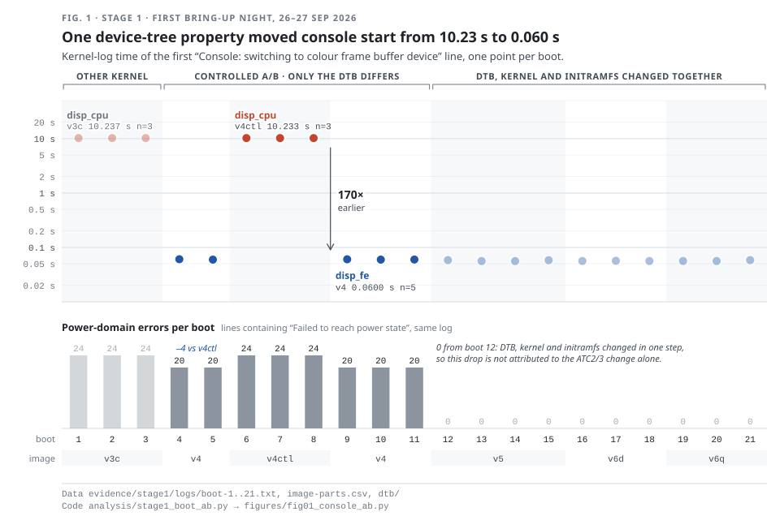

# J713 bring-up record

I wanted Linux running directly on my M4 MacBook Air. On the first night, the initramfs printed `shell on tty1`
at 0.08 s on the kernel clock. The console it was writing to appeared ten seconds later.

That gap was the first problem J713 — the MacBook Air 13" (M4, 2025), SoC T8132 — gave me, and this repository
starts there, on 26 September 2026. There was no ready way to install Linux on it: GravityLinux's installer did not
list the machine, and its board device tree was a 35-line stub on top of the shared M4 laptop tree. The work builds
on Asahi Linux's m1n1, kernel drivers and documentation, and on GravityLinux's M4 kernel, installer and Mesa.

As of 15 October 2026, all ten ARM64 cores (four performance, six efficiency) come online, and Fedora 44 runs from an ext4 root filesystem
on the internal NVMe, with KDE Plasma on the internal display. KWin composites on the M4 GPU (its own renderer
report: `Apple M4 (G16G B1)`). The internal keyboard and trackpad, Wi-Fi and Bluetooth work. When idle, the CPUs
enter WFI through a J713 path added to Asahi's cpuidle-apple driver. The display controller (DCP), suspend and audio
don't work yet. The records behind these later results will be added as their own stages; Stage 1 below covers only
the first night.

Each stage below says what I observed, what I changed and held constant, how I tested it, and what the result does
and does not show. The logs, device trees and scripts behind every figure are in this repository.

This is not an installer or a supported distribution.

## Stage 1 — First boot (26–27 September 2026)

I started working on J713 because I wanted Linux running directly on my M4 MacBook Air, not inside a virtual machine.
There wasn't a ready-to-use Linux installation path for this particular machine in the projects I was working with.
Gravity's M4 kernel gave me a starting point, but the J713 device tree was still a small board stub, and the installer
didn't recognise the 13-inch MacBook Air.

I built on the existing work from Asahi Linux and Gravity Linux, adapting the boot configuration and working through
the hardware-specific problems as they appeared.

The first challenge wasn't simply getting the kernel to execute. Linux was already running, the initramfs had
started, and all ten ARM64 CPU cores were online. But the framebuffer console was taking roughly ten seconds to
attach.

The kernel logs pointed towards a power-domain attachment failure. Rather than treating this as a general boot
performance problem, I started investigating the relationship between the framebuffer configuration and the display
power domains in the device tree.

I tested different configurations across 21 boot attempts. For the controlled comparison, I kept m1n1 and the
kernel/initramfs byte-identical, changing only the relevant device-tree configuration. Switching the framebuffer
power-domain reference from `disp_cpu` to `disp_fe` reduced the measured console attachment time from approximately
10.23 seconds to 0.06 seconds.

That was a 170-fold difference in console attachment time, not a 170-fold improvement in total system boot time. I
also returned to the previous configuration for control runs rather than relying on a single successful boot.

By the early morning of 27 September, I had Fedora 44 running with KDE Plasma on the MacBook Air's internal display.

It was far from a complete port. Graphics were still using software rendering through `llvmpipe` and the existing
framebuffer. Hardware GPU acceleration, internal input devices, wireless connectivity, audio and several other
platform components still required further work.

By 28 September, I had also verified Fedora running from a persistent ext4 root filesystem on the internal NVMe.

Getting to a desktop was an important milestone, but it wasn't the end of the work. The next challenge was making
the hardware around that desktop functional, understanding the dependencies between its components, and turning the
individual experiments into a usable Linux system.

This repository documents that process, including the unsuccessful experiments, the changes that produced measurable
results, and the limitations of what each test actually demonstrates.

<!-- fig01:begin -->
<picture>
  <source media="(prefers-color-scheme: dark)" srcset="figures/out/fig01-dark.svg">
  
</picture>

**Fig. 1 — Console start per boot, first bring-up night (26–27 Sep 2026).**
Each point is one boot (21 in total). The measured event is the printk timestamp of the first
`Console: switching to colour frame buffer device` line: the moment the kernel console attaches to the
framebuffer, not a full boot time. The initramfs wrote it into each log (`evidence/stage1/init-busybox-v6`,
line 46); `analysis/stage1_boot_ab.py` re-reads it from the log's own dmesg and stops if the two disagree.

**Controlled comparison.** v4ctl (boots 6, 7, 8, n=3) and v4
(boots 4, 5, 9, 10, 11, n=5) carry byte-identical m1n1 and kernel+initramfs
(`evidence/stage1/image-parts.csv`). The only DTB difference in meaning is
`/chosen/framebuffer@0 power-domains`: `disp_cpu` → `disp_fe` (`data/stage1/dtb_diff.txt`). Mean console start
went from 10.233 s to 0.0600 s (170.4×), and power-domain
errors from 24 to 20. In 6/6 disp_cpu boots
the log shows the framebuffer giving up on its power domain at the deferred-probe timeout (v4ctl mean
10.213 s, `pm_domain_attach_by_id(0) failed: -110`) just before the console
starts; 0/15 disp_fe boots show it.

**Not part of the comparison** (drawn faded). v3c (boots 1, 2, 3) used a different
kernel build. From boot 12 (v5) the DTB disables 22 ATC2/3 port nodes and the error count
is 0, but the kernel+initramfs changed in the same step (and m1n1 from boot 16),
so that drop is not attributed to ATC2/3 alone.

Reproduce: `make fig01` (Python 3, standard library only).
<!-- fig01:end -->

## How this repository is organised

```
evidence/   what the machine produced: per-boot logs, DTBs, image part hashes, photos (metadata removed)
analysis/   scripts that turn evidence into data; they check the evidence and stop on a contradiction
data/       the numbers and diffs the figures use
figures/    one script per figure, plus style.py shared by all of them; output in figures/out/
tools/      rasterising, README captions, the identity/secret scan
```

`make fig01` rebuilds Fig. 1 from `evidence/`. `make check` runs before every commit: it refuses
device identifiers and secrets, and checks that the evidence logs are byte-identical to the originals.
Boot images are not published: later initramfs layers contain vendor firmware. Their part hashes are
in `evidence/stage1/image-parts.csv`.

## License

- Code (`analysis/`, `figures/*.py`, `tools/`, `Makefile`, `evidence/stage1/init-busybox-v6`): MIT, see `LICENSE`.
- Text, data, figures and photos (`README.md`, `data/`, `figures/out/`, `evidence/stage1/photos/`,
  `evidence/stage1/image-parts.csv`): [CC BY 4.0](https://creativecommons.org/licenses/by/4.0/).
- The DTBs in `evidence/stage1/dtb/` are compiled from the GravityLinux and Asahi Linux device-tree sources for T8132
  and J713 (SPDX: `GPL-2.0+ OR MIT`), with the J713 changes described in Stage 1. They are not relicensed here.
- The boot logs in `evidence/stage1/logs/` are the machine's console output, published unchanged as evidence.
